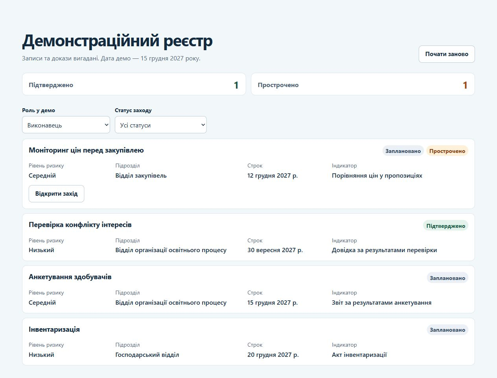

# Моніторинг корупційних ризиків НАВС

Команда «Фортпост» · Завдання 2. Цифрова система моніторингу виконання антикорупційної програми

## Проблема і користувач

Виконавці збирають докази виконання заходів, а уповноважені перевіряють їх і стежать за строками. Коли статуси й підтвердження зберігаються в окремих таблицях і документах, їх доводиться зводити вручну. Це ускладнює пошук прострочених заходів і з’ясування, який доказ ще потребує перевірки. Прототип показує, як вести цей сценарій в одному реєстрі.

## Що робить рішення

- Показує чотири вигадані заходи з підрозділом, строком, рівнем ризику, індикатором і статусом.
- Фільтрує записи за статусом і показує підсумки підтверджень та прострочень за всім реєстром.
- Приймає вибраний зразок доказу й позначку про аналіз цін у ролі виконавця.
- Дає уповноваженому підтвердити захід або повернути доказ із коментарем для повторного подання.
- Дає спостерігачу переглянути реєстр і підсумки в режимі читання.



## Демонстрація

- [Відеодемонстрація на Google Drive (2:45)](https://drive.google.com/file/d/1sxRrPFQBMdS0cnoqexbMdPzBo8npUfWH/view?usp=drivesdk)
- [Опублікований демонстраційний реєстр](https://9db6v75cmj-sys.github.io/hackathon-fortpost/#demo)

## Як запустити

Потрібні Git, Python 3 і браузер із JavaScript. Клонуйте репозиторій, відкрийте його папку та запустіть локальний сервер.

```sh
git clone https://github.com/9db6v75cmj-sys/hackathon-fortpost.git
cd hackathon-fortpost
python -m http.server 8011 --bind 127.0.0.1
```

Відкрийте реєстр у браузері, поки працює сервер. [Відкрити локальне демо](http://127.0.0.1:8011/docs/#demo)

## Як влаштовано

HTML задає розмітку й дату демо, CSS оформлює інтерфейс, а JavaScript застосовує правила до записів у пам’яті сторінки та оновлює реєстр і підсумки. Кнопка «Почати заново» або перезавантаження відновлює початковий стан. [Основна логіка](docs/demo.js)

Прострочення позначається, якщо захід ще не підтверджено і його строк раніше 15 грудня 2027 року, дати демо. Подання з вибраним зразком і позначкою про аналіз переводить захід на перевірку. Повернення та підтвердження відбуваються за дією уповноваженого.

## Документація

- Опис інтерактивного прототипу і сценарій від початкового плану до підтвердження та проєктного етапу звітності. [Демо та сценарій](docs/demo.md)
- Схема компонентів, дані в пам’яті, правила статусів і строки. [Архітектура](docs/architecture.md)
- Макети панелей керівника, координатора програми й виконавця на одному зрізі. [Рольові панелі](docs/dashboards.md)
- Макети аналітичної довідки та піврічного звіту. [Звітність](docs/reporting.md)
- Припущення, формула й прогноз економії для трьох ролей. [Економія часу](docs/time-savings.md)
- Потенційні джерела даних і перспектива обміну з Міноборони та НАЗК. [Карта інтеграції](docs/integration-map.md)
- Сценарії зловживань, наслідки й запобіжники в демо та майбутньому модулі. [Запобіжники](docs/abuse-prevention.md)
- Допомога Codex, рішення команди й розглянуті альтернативи. [Як ми використали ШІ](docs/ai.md)

## Що використали

Демо написано на HTML, CSS і JavaScript без сторонніх бібліотек. Записи й докази вбудовані та вигадані. GitHub Pages публікує реєстр, Google Drive зберігає відео, Python 3 запускає локальний сервер. Codex допоміг підготувати документацію. [Записка про ШІ](docs/ai.md)
