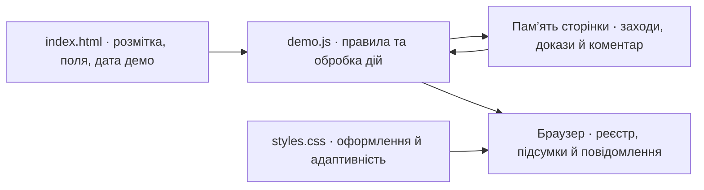

# Архітектура прототипу

HTML задає структуру сторінки, роль, фільтр і дату демо. JavaScript читає налаштування з елементів сторінки, тримає стан у пам’яті та оновлює видимі записи й підсумки. CSS задає оформлення для різних ширин екрана. GitHub Pages віддає статичні файли. Сценарій працює в браузері без серверної логіки, бази даних і викликів API. [Розмітка](index.html) · [Стилі](styles.css) · [Логіка](demo.js)

## Дані і стан

Кожен із чотирьох вигаданих записів має ідентифікатор, назву, рівень ризику, підрозділ, строк, індикатор і статус. Для моніторингу цін у пам’яті також зберігаються вибраний зразок доказу та коментар після повернення. Перемикання ролі й фільтра зберігає стан заходу. Кнопка «Почати заново» або перезавантаження відновлює вбудовані записи, роль виконавця, фільтр «Усі статуси» і закриту картку. [Сценарій відтворення](demo.md)

## Умовні ролі й переходи

Ролі перемикаються в одній сторінці. Це демонстрація доступних дій у сценарії без облікових записів. Інтерактивні переходи доступні для заходу «Моніторинг цін перед закупівлею». Решта записів доступні для перегляду й фільтрування.

| Роль і дія | Статус перед дією | Результат |
| --- | --- | --- |
| Виконавець подає вибраний зразок із позначкою про аналіз цін | Заплановано або Потребує доопрацювання | На перевірці. Повторне подання замінює доказ і прибирає попередній коментар. |
| Уповноважений повертає доказ | На перевірці | Потребує доопрацювання. Додається готовий коментар «Уточніть джерела цін у порівнянні». |
| Уповноважений підтверджує захід | На перевірці | Підтверджено. |
| Спостерігач переглядає реєстр, фільтр і підсумки | Будь-який | Статуси залишаються без змін. |

## Строки й підсумки

Дата демо зафіксована в HTML як `2027-12-15`. Позначка «Прострочено» з’являється, коли статус відрізняється від «Підтверджено» і строк заходу строго раніше дати демо. Анкетування зі строком 15 грудня відображається без цієї позначки. Підсумки рахуються за всіма записами, а фільтр змінює лише видимий перелік.
