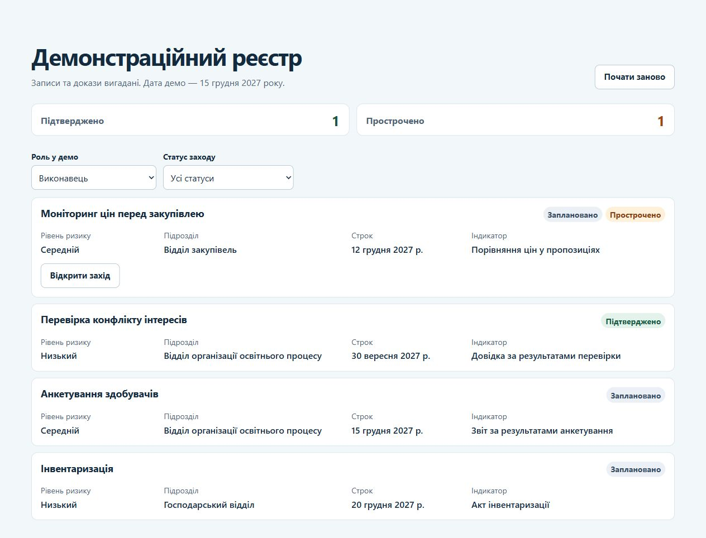

# Демонстрація прототипу і сценарій роботи

У реєстрі чотири вигадані заходи. Пройдіть сценарій моніторингу цін від вбудованого плану до рішення уповноваженого. [Відкрити опублікований реєстр](https://9db6v75cmj-sys.github.io/hackathon-fortpost/#demo) · [Переглянути відео (2:45)](https://drive.google.com/file/d/1sxRrPFQBMdS0cnoqexbMdPzBo8npUfWH/view?usp=drivesdk)

1. **Початковий план.** Натисніть «Почати заново». У ролі «Виконавець» і з фільтром «Усі статуси» знайдіть захід «Моніторинг цін перед закупівлею». За нього відповідає відділ закупівель. Строк — 12 грудня 2027 року, індикатор — порівняння цін у пропозиціях. На дату демо, 15 грудня 2027 року, захід має статус «Заплановано» і позначку «Прострочено». Підсумки реєстру — 1 підтверджений і 1 прострочений захід.
2. **Первинне подання.** Натисніть «Відкрити захід». У полі «Вигаданий доказ» виберіть «Первинне порівняння цін», установіть позначку «Додано аналіз цін» і натисніть «Подати на перевірку». Без зразка або позначки форма попросить заповнити відповідне поле. Після подання статус зміниться на «На перевірці», а позначка прострочення залишиться.
3. **Повернення.** У полі «Роль у демо» виберіть «Уповноважений». Перегляньте первинний доказ і натисніть «Повернути на доопрацювання». Захід отримає статус «Потребує доопрацювання» і коментар «Уточніть джерела цін у порівнянні».
4. **Повторне подання.** Перемкніться на «Виконавець». Прочитайте коментар, виберіть «Уточнене порівняння цін», знову встановіть позначку про аналіз і подайте доказ. Захід повернеться до стану «На перевірці». Уповноважений побачить уточнений зразок, а коментар до попереднього подання зникне.
5. **Підтвердження і перегляд.** У ролі «Уповноважений» натисніть «Підтвердити захід». Підсумки зміняться на 2 підтверджені та 0 прострочених. Перемкніться на «Спостерігач», щоб переглянути реєстр, підсумки й фільтр у режимі читання.
6. **Проєктний етап звітності.** Майбутній модуль використовуватиме дані реєстру для аналітичної довідки та піврічного звіту. У макетах показано проміжний зріз одразу після кроку 2, коли доказ ще чекає рішення уповноваженого. [Макети звітності](reporting.md)

